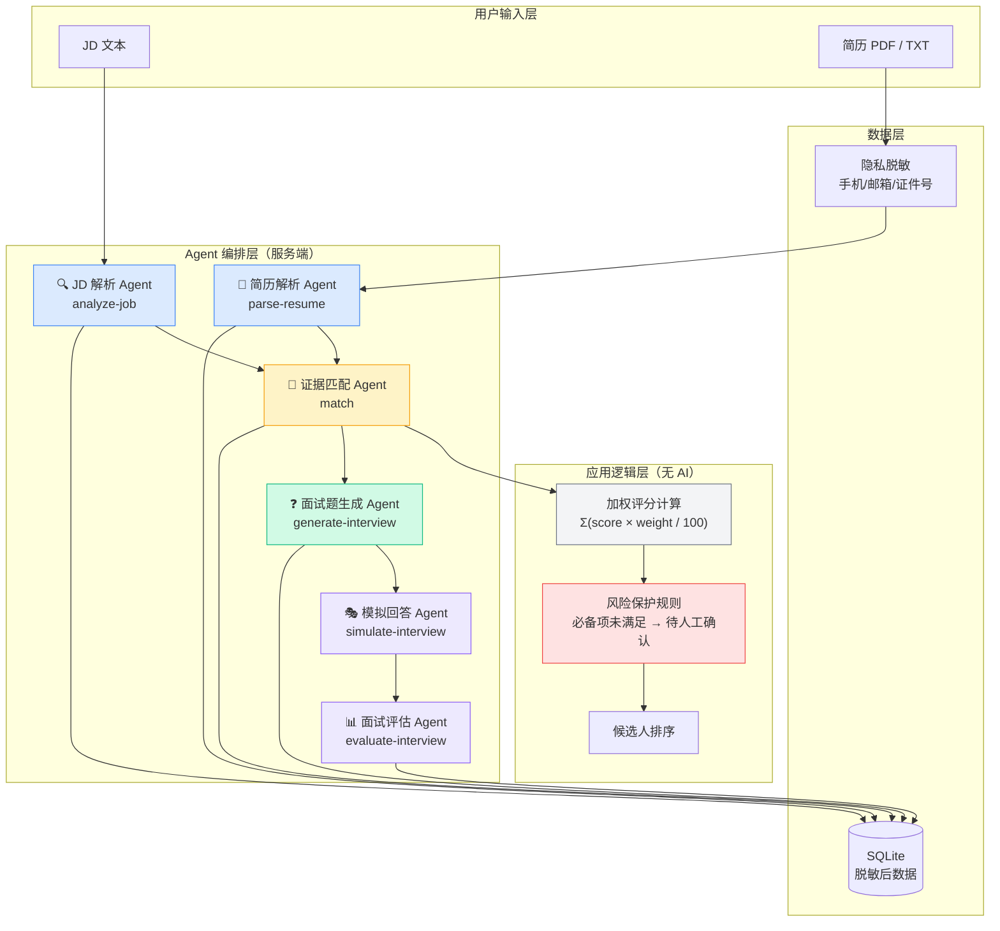

# HireFlow 多 Agent 架构设计

> 关联文档：[PRD](../prd/hireflow-v1-prd.md) · [Prompt 设计](./prompt-engineering.md) · [评测体系](../evaluation/harness-design.md)

---

## 1. 为什么需要多 Agent

单一 Agent 处理"JD→简历→匹配→面试"全链路的问题：

| 问题 | 影响 |
|---|---|
| 上下文过长（JD + 简历 + 全部历史），注意力稀释 | 匹配质量下降，证据引用不精确 |
| 单一 Prompt 承担多种角色，角色冲突 | 模型在"分析师"和"评判者"之间摇摆 |
| 任一步骤失败导致全链路重跑 | 成本高、延迟高 |
| 无法对单个 Agent 独立测试和优化 | 质量问题难以定位 |

HireFlow 将链路拆分为 **6 个职责单一的 Agent**，每个 Agent 有独立的系统提示、输入/输出 Schema 和独立的可测试性。

---

## 2. 总体架构



---

## 3. Agent 详细设计

### 3.1 JD 解析 Agent（analyze-job）

| 项目 | 内容 |
|---|---|
| **职责** | 将自然语言 JD 转换为结构化能力模型 |
| **输入** | 原始 JD 文本（任意格式） |
| **输出** | `{ title, summary, responsibilities[], requirements[], ambiguities[] }` |
| **关键约束** | requirements 数量 3-10 项；不得引入 JD 中没有依据的硬性门槛 |
| **调用时机** | 用户创建岗位时，一次性调用 |
| **失败处理** | Zod 校验失败 → 携带校验反馈自动重试 1 次 |

**输出 Schema（核心字段）：**
```typescript
requirements: [{
  id: string,           // 英文短标识，用于后续 match 对应
  label: string,        // 能力名称（显示用）
  detail: string,       // 可判断的要求描述
  weight: number,       // 0-100 整数，合计 100
  kind: "必备" | "加分"
}]
```

**设计决策**：权重由模型建议，HR 可调整；应用层强制验证合计等于 100，而非依赖模型保证。

---

### 3.2 简历解析 Agent（parse-resume）

| 项目 | 内容 |
|---|---|
| **职责** | 从简历文本中提取结构化 Profile，只提取明确事实 |
| **输入** | 脱敏后的简历文本（PDF 在服务端提取，TXT 直传） |
| **输出** | `{ candidateName, headline, experienceYears, experiences[], skills[], achievements[], missingInformation[] }` |
| **关键约束** | 不得补写、虚构任何经历；信息不足时放入 missingInformation |
| **调用时机** | 每份简历上传时，独立调用 |

**隐私处理流程：**
```
客户端提取 PDF 文字（pdfjs，浏览器端）
  → 传到服务端
  → redactSensitiveText()：正则替换手机/邮箱/身份证号/姓名标注段
  → 脱敏文本发送模型
  → 脱敏文本 + 结构化结果写入 DB
  → 原始文件不落库
```

---

### 3.3 证据匹配 Agent（match）⭐ 核心 Agent

| 项目 | 内容 |
|---|---|
| **职责** | 逐一评价每个岗位要求，给出分数和简历原文证据 |
| **输入** | 岗位要求列表 + 简历全文 |
| **输出** | 逐项 `{ requirementId, status, score, evidenceQuote, reasoning, interviewFocus }` + summary + gaps + risks + recommendation |
| **关键约束** | evidenceQuote 必须是可在简历原文中直接搜索到的连续字符串；无证据时为空字符串 + 待验证 |

**防幻觉设计：**

```
❌ 禁止：综合来看候选人有 AI 产品经验
✅ 必须：evidenceQuote: "主导 GPT-4 接入方案设计，3个月上线"

❌ 禁止：因为简历出现了"AI"关键词就认定有 AI 产品经验
✅ 必须：evidenceQuote: "" + status: "待验证"
```

**分数与总分分离：**

```
模型输出：每项 score（0-100）
应用层计算：totalScore = Σ(item.score × item.weight) / 100

这样做的原因：
1. 模型容易在"给结论"和"分析步骤"之间混淆
2. HR 修改权重时无需重跑 Agent
3. 总分逻辑可单独测试
```

**风险保护规则（应用层，非 Agent）：**

```typescript
// 必备项有任意一项得分 < 40 → 推荐结论强制变为"待人工确认"
const hasFailedMustHave = matches
  .filter(m => m.kind === "必备")
  .some(m => m.score < 40);

if (hasFailedMustHave && recommendation === "推荐面试") {
  recommendation = "待人工确认";
}
```

---

### 3.4 面试题生成 Agent（generate-interview）

| 项目 | 内容 |
|---|---|
| **职责** | 基于差距和风险项生成 6 道结构化面试题 |
| **输入** | 岗位要求 + 匹配结果（重点关注低分项、待验证项） |
| **输出** | `questions[{ id, type, skill, question, rationale, relatedRequirementId }]` |
| **关键约束** | 6 道不重复；禁止涉及年龄婚育健康民族；优先验证高权重和差距项 |

**面试题类型设计：**

| type | 适用场景 |
|---|---|
| `经历追问` | 简历有提到但证据不详，需要验证深度 |
| `能力验证` | 必备项待验证，需要候选人现场展示 |
| `情景问题` | 未来工作场景，测试思维框架 |
| `风险核验` | 简历有潜在矛盾或信息缺口 |

---

### 3.5 模拟回答 Agent（simulate-interview）

| 项目 | 内容 |
|---|---|
| **职责** | 基于简历事实生成第一人称模拟回答（演示/培训用） |
| **输入** | 面试题 + 候选人简历 Profile |
| **输出** | `answers[{ questionId, answer }]`（120-220 字，STAR 结构） |
| **关键约束** | 只能引用简历明确事实；禁止虚构；信息不足时说"从现有经历无法确认" |
| **定位** | 演示工具，非正式候选人评估路径 |

---

### 3.6 面试评估 Agent（evaluate-interview）

| 项目 | 内容 |
|---|---|
| **职责** | 逐题评估回答质量，产出推进建议 |
| **输入** | 面试题 + 候选人回答 |
| **输出** | `{ recommendation, executiveSummary, strengths[], risks[], followUps[], evaluations[] }` |
| **评分维度** | STAR 完整度 / 简历证据一致性 / 专业深度（各 0-100） |
| **关键约束** | 不得因简历未披露信息做负面推断；发现回答超出简历时必须在 concerns 标注 |

---

## 4. 编排模式：顺序链（Sequential Chain）

HireFlow v1 使用**顺序链**而非并发编排：

```
A1(JD解析) → A2(简历解析) → A3(匹配) → A4(面试题) → A5(模拟) → A6(评估)
```

**选择顺序链的原因：**

1. 每个 Agent 的输出是下一个 Agent 的关键输入，存在强依赖
2. 用户希望在每步之间做人工干预（调整权重、查看结果）
3. v1 阶段不需要并行处理多候选人（演示场景）

**v2 规划的并发优化：**

```
                    ┌→ A2(简历A) → A3(A) ┐
JD解析(A1) ──批次───┤→ A2(简历B) → A3(B) ├→ 合并排序
                    └→ A2(简历C) → A3(C) ┘
                    （简历解析和匹配可以并发）
```

---

## 5. 有无 Harness：评测体系设计

> 详细设计见 [评测 Harness 设计文档](../evaluation/harness-design.md)

HireFlow 有专门的离线评测 Harness，这是与大多数 AI 工具的核心区别：

```
eval/cases.ts        ← 测试用例定义（30条：18常规+8边界+4公平性）
scripts/run-evaluation.ts  ← 评测脚本（运行所有 cases，调用真实 Agent）
output/evaluation/   ← 评测结果（JSON + CSV + Markdown 报告）
```

**Harness 的作用：**
- 在模型升级或 Prompt 修改时，快速验证是否引入回归
- 边界用例确保系统不在极端情况下失控
- 公平性反事实测试确保名字/学校差异不影响评分

---

## 6. 关键架构决策记录（ADR）

### ADR-01：分数由应用层计算，而非 Agent 直接给总分

**决策**：Agent 只给单项分（0-100），加权总分由 TypeScript 代码计算

**原因**：
- 模型给总分时容易受"整体印象"影响，绕过单项证据
- HR 调整权重时无需重跑 Agent
- 总分计算逻辑可以用单元测试完全覆盖

**代价**：需要维护客户端和服务端的权重同步

---

### ADR-02：必备项保护规则放在应用层，而非 Agent 提示词

**决策**：用代码硬编码"必备项未满足 → 推荐结论不得为推荐面试"这个规则

**原因**：
- Prompt 中的指令模型可能忽略；代码规则不会被忽略
- 规则改变时不需要改 Prompt，只改代码，可单独测试
- 评测结果显示模型在边界案例下风险保护准确率仅 76.7%，不够可靠

---

### ADR-03：temperature=0.1，不使用 CoT thinking

**决策**：所有 Agent 调用均使用低温度，关闭 thinking 模式

**原因**：
- 招聘评分场景需要稳定可复现，不需要创意
- thinking 模式延迟显著增加
- 稳定性复测（同一案例 3 次）验证：分数波动最大为 15 分（可接受范围）

---

### ADR-04：evidenceQuote 可定位性作为核心质量指标

**决策**：评测时专门检测 evidenceQuote 是否可在简历原文中搜索到

**原因**：
- 引用不可定位 = 幻觉，是招聘场景最不能接受的问题
- 95.7% 的引用定位率是 v1 质量基线，v2 目标 ≥ 98%
- 这个指标与"最终推荐对不对"相比更客观、更可自动化检测
