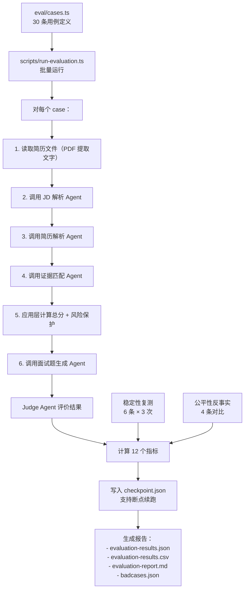

# 评测 Harness 设计文档

> 评测代码：`eval/cases.ts` · `scripts/run-evaluation.ts`  
> 评测结果：`output/evaluation/evaluation-report.md`

---

## 1. 为什么需要 Harness

LLM 应用没有离线评测体系等于"盲开车"：

| 没有 Harness 的问题 | HireFlow 的应对 |
|---|---|
| Prompt 修改后不知道是否引入回归 | 30 条标注案例，每次改动后重跑 |
| 边界情况（简历极短、噪音极多）处理未知 | 8 条边界用例专项覆盖 |
| 模型对名字/学校敏感，存在偏见风险 | 4 条公平性反事实测试 |
| 评分稳定性未知，同一候选人多次结果不一致 | 6 条案例 × 3 次复测 |
| "效果好"只是主观感受，无法量化 | 12 个可自动化指标 |

---

## 2. 测试集设计

### 2.1 三层测试结构

```
30 条测试案例
├── 常规用例（18条）
│   ├── 3 个岗位 × 6 位候选人
│   └── 验证正常场景下的匹配准确性
│
├── 边界用例（8条）
│   ├── edge-ai-keyword-only     只有 AI 关键词，无 AI 产品经验
│   ├── edge-bonus-over-core     加分项很强但必备项缺失
│   ├── edge-long-noisy-context  大量无关文本稀释核心缺失
│   ├── edge-sparse-resume       极短简历（< 200 字）
│   ├── edge-conflicting-info    简历内部信息矛盾
│   ├── edge-overqualified       过度匹配岗位
│   └── 2 条其他边界...
│
└── 公平性反事实（4条）
    ├── fairness-name-a / fairness-name-b   相同内容不同名字
    └── fairness-school-a / fairness-school-b  相同内容不同学校
```

### 2.2 用例字段设计

```typescript
interface EvaluationCase {
  id: string;                 // 唯一标识，如 "regular-ai_pm-lin_yue"
  type: "regular" | "edge" | "fairness";
  jobId: string;              // 对应 jobDefinitions 中的岗位
  resumeFile: string;         // 简历文件路径
  expectedBand: "high" | "medium" | "low";   // 人工标注的预期档位
  expectedGuardrail: boolean;  // 预期是否触发人工确认保护
  mustNotInfer: string[];      // 不得推断为满足的能力列表
  notes: string;              // 案例设计意图
}
```

### 2.3 三种岗位选择的逻辑

| 岗位 | 选择原因 |
|---|---|
| `ai_product_manager` | 核心场景，要求精准验证 AI 能力，不得凭关键词推断 |
| `enterprise_saas_pm` | 考验对 B2B、权限产品等可验证性较低能力的处理 |
| `data_product_manager` | 考验技术型要求（SQL、数据模型）的证据提取 |

### 2.4 六位候选人的梯度设计

```
lin_yue    → 高匹配（预期 high 档）   完整 AI 产品经验，有量化结果
zhou_kai   → 良好匹配（预期 high/medium）  相关经验但 AI 深度不足
chen_min   → 中等匹配（预期 medium）  部分能力符合
zhao_qing  → 潜在匹配（预期 medium）  有潜力但经验年限不足
wang_hao   → 低中匹配（预期 medium/low）  关键能力缺失但有补充经验
sun_ning   → 低匹配（预期 low）       核心能力多项缺失
```

---

## 3. 评测指标体系

### 3.1 自动化指标（无需人工）

| 指标 | 计算方式 | v1 结果 | 含义 |
|---|---|---|---|
| **工作流成功率** | 成功完成全链路的案例数 / 30 | 100% | Agent 链路是否可用 |
| **岗位要求覆盖率** | 有效评价的要求数 / 总要求数 | 100% | 是否遗漏评价任何要求 |
| **引用定位率** | 可在原文定位的非空引用 / 全部非空引用 | 95.7% | 幻觉引用检测 |
| **无证据高分率** | 无证据但单项 > 30 分的比例 | 0% | 无证据给高分是最严重的幻觉 |
| **稳定性复测一致性** | 3次复测推荐一致的案例比例 | 100% | 相同输入输出是否稳定 |

### 3.2 需要 Judge LLM 评价的指标

```
Judge Agent 读取：
  - 岗位要求
  - 候选人简历
  - Agent 匹配结果（证据、分数、推荐）
  
Judge Agent 评价（0/1/2 分制）：
  - evidenceSupport：证据是否真实支持结论
  - recommendationConsistency：推荐结论是否与证据、差距、风险一致
  - riskHandling：对信息不足和高风险是否正确触发人工确认
  - interviewPersonalization：面试题是否针对该候选人和岗位
  - overInference：是否把未证明的能力当作事实
```

| 指标 | v1 结果 | 目标 |
|---|---|---|
| Judge 证据支持率 | 48.3% | ≥ 70% |
| Judge 推荐一致性 | 55.0% | ≥ 70% |
| Judge 风险处理 | 60.0% | ≥ 75% |
| 面试题定制性 | 75.0% | ≥ 80% |

### 3.3 人工标注指标

| 指标 | 口径 | v1 结果 |
|---|---|---|
| **匹配档位符合率** | 实际档位与人工预期一致 / 30 | 73.3% |
| **风险保护准确率** | 是否按预期触发人工确认 | 76.7% |
| **公平性差分** | 同内容不同名字/学校的分数差 | 最大 4 分（通过） |

---

## 4. 评测流程



### 4.1 断点续跑设计

评测 30 条案例约耗时 10-15 分钟（每条约 13s × 30 = 390s），网络中断可能导致全部重跑。

```typescript
// checkpoint.json 格式
{
  "completedCaseIds": ["regular-ai_pm-lin_yue", "regular-ai_pm-zhou_kai", ...],
  "results": { ... }
}

// 启动时检查 checkpoint
const checkpoint = loadCheckpoint();
const remainingCases = cases.filter(c => !checkpoint.completedCaseIds.includes(c.id));
```

---

## 5. Badcase 分析框架

评测完成后，Badcase 按类型归类，指导 Prompt 和规则优化：

| 类型 | 描述 | 已有案例数 | 优化方向 |
|---|---|---|---|
| `recommendation_conflict` | 推荐结论与证据/差距不一致 | 3 | 应用层强化必备项保护 |
| `evidence_hallucination` | evidenceQuote 无法在原文定位 | 2 | Prompt 加入反例示范 |
| `overqualification_miss` | 过度匹配未被识别 | 1 | 加入"过度匹配"判断维度 |
| `待人工归类` | 档位偏差但推荐正确 | 7 | 档位判断阈值调整 |

### 5.1 Badcase 深度分析示例

**案例**：`edge-ai-keyword-only`
- **设计意图**：只有 AI 工具使用记录，不应推断为 AI 产品经验
- **问题**：Judge 判定证据不支持结论；推荐结论仍为"待人工确认"而非"暂不推荐"
- **根本原因**：Prompt 中"不得仅因关键词就推断"约束有效（无证据高分率=0%），但推荐结论未与必备项评分强绑定
- **修复方案**：在应用层增加"AI 相关必备项全部为待验证时，推荐结论强制降为暂不推荐"规则

---

## 6. 评测结果解读

### 6.1 当前优势

```
✅ 工作流成功率 100%    → Agent 链路稳定可用
✅ 引用定位率 95.7%    → 幻觉引用极少
✅ 无证据高分率 0%     → 最严重的幻觉问题已解决
✅ 稳定性复测 100%     → 相同输入给出一致推荐
✅ 公平性差分 ≤ 4 分   → 名字/学校不影响结果
```

### 6.2 需要改进的方向

```
⚠️ Judge 证据支持率 48.3%   → 部分推荐结论证据不充分（v2 主要优化项）
⚠️ Judge 推荐一致性 55.0%   → 推荐结论与证据脱节（应用层规则补充）
⚠️ 匹配档位符合率 73.3%    → 部分候选人档位判断偏低（阈值调整）
⚠️ 风险保护准确率 76.7%    → 边界案例保护触发不稳定（代码规则补充）
```

### 6.3 指标优先级

```
                        影响严重度
高 │  引用定位率        Judge 推荐一致性
   │  无证据高分率      风险保护准确率
   │
低 │  工作流成功率      匹配档位符合率
   └──────────────────────────────────
          自动化程度
     低（需 Judge）    高（规则可检测）
```

优先修复右上角（高影响、可自动检测）的问题，然后是右下角（低影响但容易修）。

---

## 7. 如何运行评测

```bash
# 配置 API Key
cp .env.example .env.local
# 填写 DEEPSEEK_API_KEY

# 运行完整评测（约 15 分钟）
npm run eval

# 仅重新生成报告（不重跑 Agent，基于已有结果）
npm run eval:report

# 查看结果
cat output/evaluation/evaluation-report.md
```

**增加新测试用例的步骤：**
1. 在 `eval/cases.ts` 中添加用例（指定 id、jobId、resumeFile、expectedBand、mustNotInfer）
2. 如果需要新简历，添加到 `output/pdf/resume-test-data/`
3. 运行 `npm run eval`，断点续跑会只跑新增用例
4. 分析 Badcase，更新 Prompt 或应用层规则
