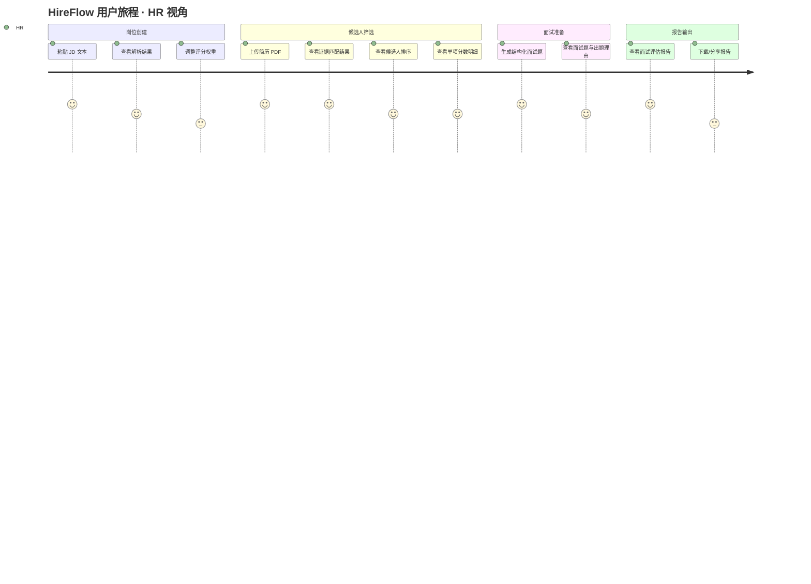
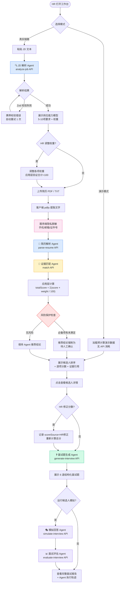
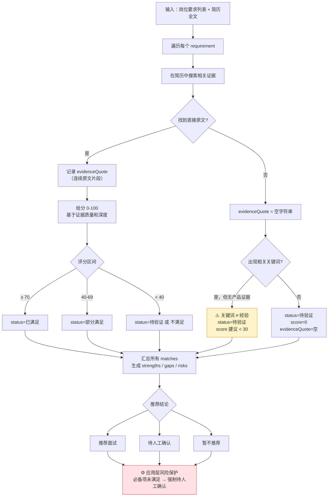
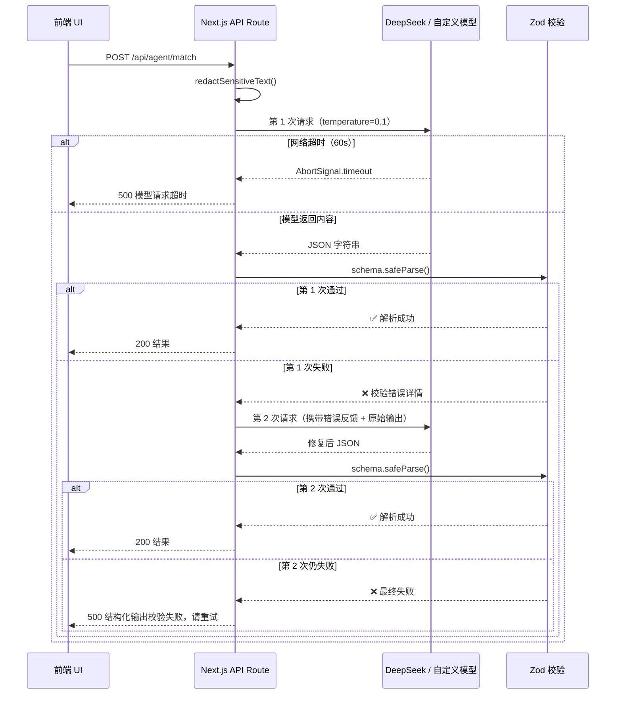
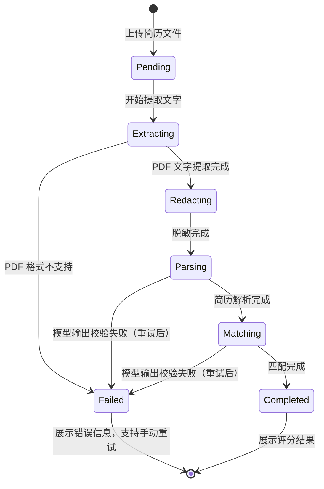

# Agent 工作流与用户旅程

> 本文包含完整的 Mermaid 流程图，在 GitHub Markdown 中直接渲染。

---

## 1. 完整用户旅程（含系统行为）



---

## 2. 主链路：JD → 候选人报告



---

## 3. 证据匹配 Agent 内部逻辑



---

## 4. 错误处理与重试流



---

## 5. 批量简历处理工作流（v1 实现）



---

## 6. 演示模式 vs 真实链路对比

```mermaid
flowchart LR
    subgraph DEMO["演示模式（稳定演示）"]
        D1[点击"运行完整样例"] --> D2[加载 demo-data.ts\n预计算结果]
        D2 --> D3[立即展示所有候选人\n无延迟无 API 消耗]
    end

    subgraph REAL["真实链路（消耗 API）"]
        R1[点击"创建职位"] --> R2[粘贴 JD → 调用 AI]
        R2 --> R3[上传简历 → 调用 AI]
        R3 --> R4[实时返回证据匹配结果]
    end

    DEMO -.->|"相同的 UI 组件\n不同的数据来源"| REAL
```

> **设计意图**：演示模式确保任何时候都有可复现的稳定演示，不依赖 API 可用性。真实链路展示系统的实际能力。两套路径共用完全相同的 UI 组件，由数据来源区分。
